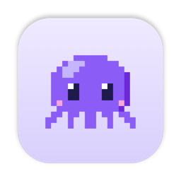
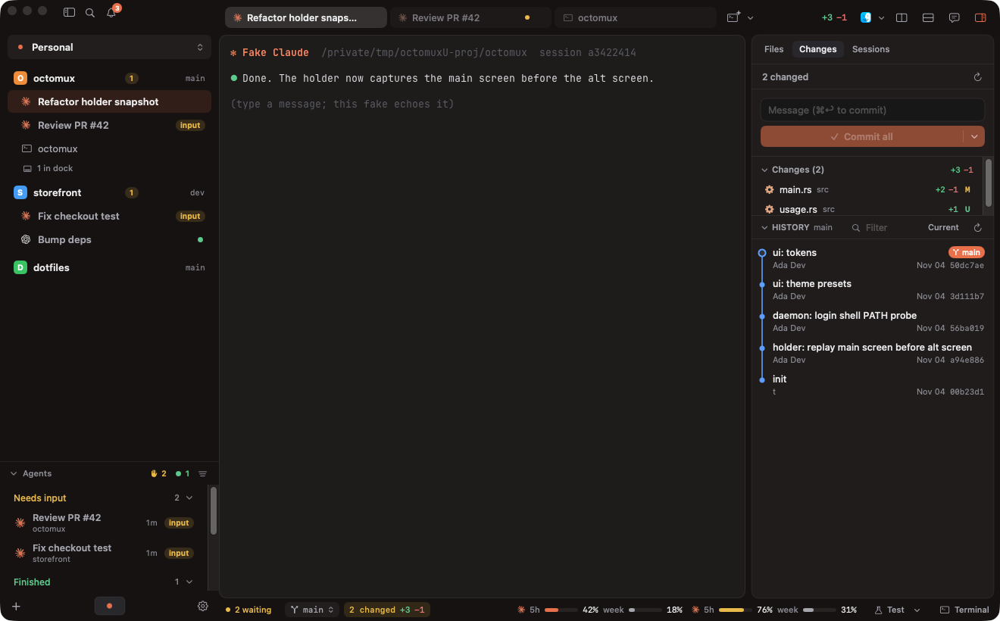
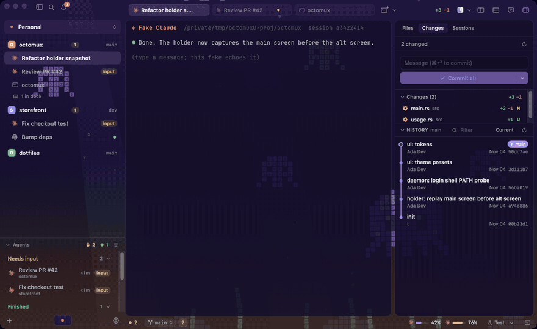
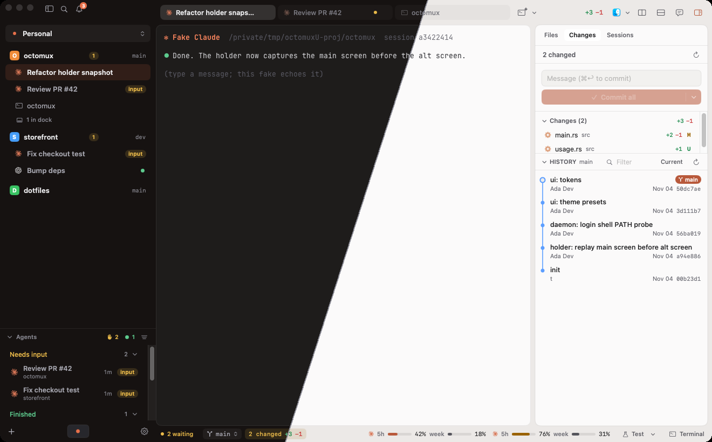

<p align="center">
  
</p>

<h1 align="center">Octomux</h1>

<p align="center">
  <b>A native macOS home for your terminals and coding agents.</b><br/>
  Sessions live in a background daemon — quit the app, crash, or reboot, and your work is still there.
</p>

<p align="center">
  <a href="https://github.com/anilsenay/octomux/releases/latest"><b>Download</b></a> · <a href="docs/GUIDE.md">Guide</a> · <a href="#supported-agents">Agents</a> · <a href="docs/DEVELOPMENT.md">Build from source</a> · <a href="CONTRIBUTING.md">Contributing</a>
</p>

<p align="center">
  
</p>

---

- **Sessions that outlive the app.** Every terminal runs in its own holder process under a launchd daemon. Close the
  window, quit, update, or crash — reopen and you are exactly where you were. After a reboot, Claude Code and
  Codex sessions come back with `--resume` and continue the same conversation.
- **Know which agent needs you.** Each agent is marked *working*, *needs input* or *done* in the sidebar, the tab
  and the menu bar. Notifications take you straight to the right pane; ⌘⇧U jumps to the next one waiting.
- **Built for parallel agents.** Workspaces and projects, tabs, splits, a dock, and one-click git worktrees so
  several agents can work on the same repo without stepping on each other.
- **Git without leaving the window.** The right panel follows the focused session: changed files, commit &
  push, history with diffs, and a file tree with a code viewer.
- **Your agents, unwrapped.** Claude Code, Codex and any other CLI agent run as themselves, with your own config
  and login. Octomux owns the terminal, not the agent. Optional chat view for Claude sessions.
- **Usage at a glance.** 5-hour and weekly limits for Claude and Codex in the status bar.
- **Remote hosts.** Run the daemon on a Linux box over SSH and keep its sessions next to your local ones.
- **Fast and native.** Swift + AppKit, GPU-rendered terminals by [libghostty](https://github.com/ghostty-org/ghostty),
  a small Rust daemon. No Electron.
- **Make it yours.** Theme presets, light and dark, animated pixel-art scenes behind your terminals (the octopus
  ones are the house favorites), rebindable shortcuts and a ⌘K command palette.

## Themes and scenes

Plain dark and light, three theme presets, or one of more than twenty animated pixel-art scenes that show
through translucent terminals. Pick them in Settings → Appearance or with ⌘K "Theme".

<p align="center">
  
</p>

<p align="center">
  
</p>

## Install

1. Download **Octomux.dmg** from the [latest release](https://github.com/anilsenay/octomux/releases/latest).
2. Open it and drag **Octomux** into **Applications**.
3. Open Octomux. It installs its background service (a launchd agent) on first launch and asks for
   notification permission.

macOS 14 or later, Apple Silicon. Signed and notarized, so it opens without a Gatekeeper prompt. If you open it
straight from the disk image or Downloads, Octomux offers to move itself to Applications first (its background
service needs a fixed place).

Octomux updates itself: when a new version is out, a small card in the corner offers to install it, and your
sessions keep running through the update.

## Supported agents

Any CLI agent runs in Octomux, since it is just a terminal. Some get more:

| Agent | Keeps running when the app quits | Working / needs-input status | Resume after reboot | Usage limits | Chat view |
|---|:-:|:-:|:-:|:-:|:-:|
| Claude Code | ✓ | ✓ | ✓ | ✓ | ✓ |
| Codex | ✓ | — | ✓ | ✓ | — |
| Gemini, Amp, OpenCode, Cursor, Kiro, Antigravity, Copilot, your own | ✓ | — | — | — | — |

Installed agents are detected in Settings → Agents, including shell aliases (a second Claude account, say).
Codex status tracking is next on the list. Want deeper support for another agent?
[Open an agent request](https://github.com/anilsenay/octomux/issues/new?template=agent_request.yml).

## Getting started

- **Add a project:** ⌘⇧O and pick a folder.
- **Start an agent:** the agent buttons next to **+** at the bottom of the sidebar, or ⌘⇧T for the first pinned one.
  Installed CLIs are listed in Settings → Agents.
- **New terminal / split:** ⌘T, ⌘D (right), ⌘⇧D (down).
- **Find anything:** ⌘K opens the command palette (sessions, projects, commands, themes, settings).

The [guide](docs/GUIDE.md) covers worktrees, the right panel, the chat view, usage limits, remote hosts,
keyboard shortcuts and uninstalling.

## How it works

```
Octomux.app (Swift, AppKit + SwiftUI)
  ├─ each pane = a libghostty surface attached to a session
  └─ control connection ──▶ octomux daemon (Rust, launchd agent)
                               ├─ SQLite catalog: workspaces, projects, tabs, sessions, agents, settings
                               ├─ agent hooks → activity, notifications, usage
                               └─ one `octomux holder` per session (PTY + headless terminal state)
                                    └─ survives app quits, daemon restarts and updates
```

## Privacy

Octomux is local-first: no account, no analytics, no telemetry. Your sessions, projects and settings live in a
SQLite database in `~/Library/Application Support/Octomux/`. Octomux itself only goes online to check for
updates (a plain download of the update feed, no system profile) and when you import a scene from a URL. Your agents talk to
their own providers exactly as they would in any other terminal.

## Build from source

You need Xcode (with the Metal toolchain), Rust stable and Zig 0.17.

```sh
git clone https://github.com/anilsenay/octomux && cd octomux
tools/build-ghostty.sh        # libghostty at the pinned commit, once
tools/build-app.sh            # → build/Octomux.app
open build/Octomux.app
```

Tests, the debug harness, the UI fixture and the release process are in [docs/DEVELOPMENT.md](docs/DEVELOPMENT.md).

## Contributing

Bug reports and ideas are very welcome. Please read [CONTRIBUTING.md](CONTRIBUTING.md) before opening a pull request.

## Thanks

Octomux stands on [Ghostty](https://github.com/ghostty-org/ghostty) (terminal engine),
[Sparkle](https://sparkle-project.org) (updates), [CodeMirror](https://codemirror.net) (code viewer) and
[Simple Icons](https://simpleicons.org) (agent marks). See [THIRD_PARTY_NOTICES.md](THIRD_PARTY_NOTICES.md).

## License

Octomux is released under the [MIT License](LICENSE).
