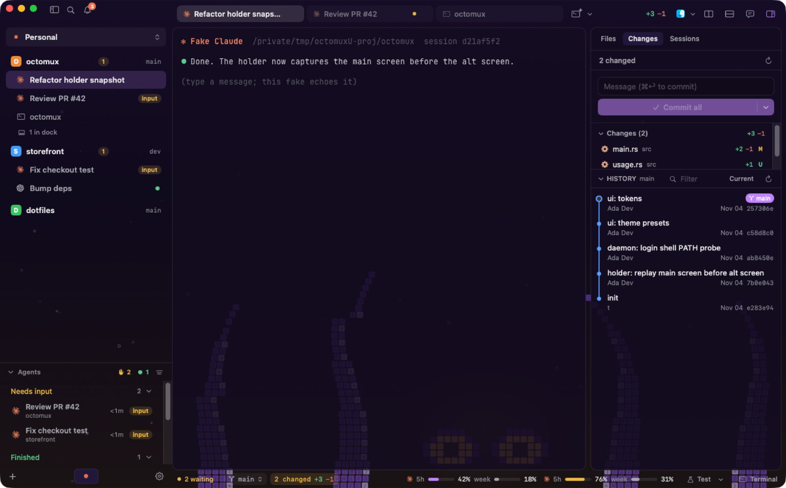

# Octomux guide

## Workspaces, projects and sessions

- A **workspace** groups projects (Personal, Work, a client). ⌃1…⌃9, ⌃⌘← ⌃⌘→ or a two-finger swipe over the
  sidebar switches between them; each has its own color.
- A **project** is a folder. Its sessions (agents and terminals) are listed under it in the sidebar.
- Sessions run in the background daemon, one holder process each. Quitting or updating the app, or a daemon
  restart, doesn't stop them. After a reboot, agents come back with `--resume` (same conversation); plain
  terminals come back as a fresh shell in the same directory.
- The **Agents** section at the bottom of the sidebar lists every agent across workspaces by state: needs input,
  working, done.

## Agents

Settings → Agents lists the agent CLIs installed on this Mac (Claude Code, Codex and others) and lets you add
your own (any command, e.g. an alias that uses another account). Pinned agents get a button next to **+**.
Editing an agent sets its start options from lists: model, effort and permission mode for Claude Code; model,
effort, approvals and sandbox for Codex. They are written as flags into the agent's Arguments, and a new chat's
own choices go on top.

Settings → General → Open in picks the apps in every Open in menu, their order, the default one (⌘O and the top
bar's button), and any other app you add.

Octomux doesn't wrap the agent: it runs your CLI with your config and login. For Claude Code it passes its
hooks and status line with `--settings` (your `~/.claude/settings.json` is left alone) to know when an agent is
working, waiting for input, or done.

Codex needs nothing set up: from version 0.164 on it reports its own state to the terminal (working, waiting
for your approval, done), and Octomux reads it, also when you type `codex` in a terminal tab. Octomux finds the
conversation from the file Codex keeps open, so the tab shows its name, the chat view follows it, and a restored
tab reopens it with `codex resume`. Older Codex versions show working and done only; Settings → Agents shows
which version you have.

## Notifications and the menu bar

When an agent finishes or needs input, you get a macOS notification; clicking it focuses that pane. The bell in
the top bar keeps the recent ones, and ⌘⇧U jumps to the next session waiting for input. The menu bar icon
animates while agents work, shows a dot for unread notifications, and opens a panel of recent activity.
Settings → Notifications shows whether macOS allows Octomux's notifications, sends a test one, and picks a sound
for each kind (agent finished, needs input, error, commands and programs); Settings → Appearance → Icons sets the
menu bar icon (color, monochrome or hidden). A workspace can override notification and appearance settings: pick
Workspace at the top of those pages.

## Worktrees and the right panel

Project right-click → **New Worktree…** creates a branch in `<parent>/<repo>.worktrees/<branch>` and opens it
with an agent or a terminal. Worktrees show under their project (right-click to open, reveal or remove).

⌘⌥B opens the right panel, which follows the focused session's folder:

- **Files**: tree, filter, preview, Open in.
- **Changes**: changed files with diffs, commit all / commit & push. **History** sits at the bottom of Changes:
  collapsed it is a header; open it shows commits and their diffs (drag its top edge to resize).
- **Sessions**: the project's sessions.

## Chat view (Claude and Codex)

⌘⇧C (or the speech-bubble button in the top bar) shows a Claude or Codex session as a chat: its own transcript, live,
with tool calls as cards. What you type there goes into the same session, as if typed in the terminal.
Permission prompts and menus are answered in the terminal (the chat offers a one-click switch). Turn it off in
Settings → Features.

## Usage limits

Claude sessions started by Octomux get a status line command (`octomux statusline`, injected with `--settings`
like the hooks). It reports the 5-hour and weekly limits to the daemon at most every 15 s and then runs **your
own** `statusLine` command with the same input, so your status line is unchanged. Codex limits are read from
its rollout files while a Codex session runs. The status bar shows the focused agent's profile plus profiles
marked "Always show". The meters show what is used or what is left (Used / Left in their popover, or
Settings → Agents → Usage limits).

## Remote hosts

1. Build `octomux` for the server: `rustup target add x86_64-unknown-linux-gnu && tools/build-linux.sh x86_64`
   (or `aarch64`; needs `zig`). Copy `core/target/<arch>-unknown-linux-gnu/release/octomux` to the server,
   e.g. `~/.local/bin/octomux`.
2. Settings → Hosts → Add host: an SSH destination (`user@box` or a `Host` from `~/.ssh/config`; key or agent
   auth, no prompts) and the path of `octomux` there. **Test**, then **Connect**, or pick it in the workspace menu.
3. The daemon on the server starts on first use and keeps sessions running after you disconnect (run
   `octomux daemon` under systemd if it should survive server reboots).

With Settings → Features → "Hosts side by side", hosts marked "Show here" appear next to this Mac's projects.
SSH hosts share one connection per host (OpenSSH `ControlMaster`, socket in `/tmp/octomux-ssh-<uid>/`, kept
10 minutes after last use) unless your ssh options set `ControlMaster` / `ControlPath` themselves. Custom
command hosts take any prefix that reaches the other side, e.g. `docker exec -i <container>`.

## Appearance

Settings → Appearance (or ⌘K "Theme"): theme presets (**Ink**, **Grid**, **Glass**), Dark / Light / System, and
**scenes**: animated pixel-art backdrops (Octo Deep, Kraken, Tide Pool and more) that can show through
translucent terminals. You can make your own scene from a JSON file. Terminal colors follow the theme
(`theme.conf`, loaded after your `terminal.conf`); turn off "Use theme colors in the terminal" to use your own.

## Terminal

Settings → Terminal sets the font (any installed monospaced font, or the built-in JetBrains Mono), its size, line
height, the cursor style and blink, and how many lines of scrollback a terminal keeps. Terminals change as you
pick. These controls write single lines of `terminal.conf`; the editor under them shows the whole file, for
anything else Ghostty's config syntax offers. *Import from Ghostty* copies your Ghostty font and colors.

Closing a tab or pane asks first when something in it is still running: an agent that is working or waiting for
you, or a program other than the shell in a terminal (a dev server, vim, a build). Turn this off with "Ask before
closing a running program" or "Don't ask again" in the question.



## Keyboard

| | |
|---|---|
| ⌘T / ⌘⇧T | New terminal tab / new tab with the first pinned agent |
| ⌘D / ⌘⇧D | Split right / down |
| ⌘W | Close pane |
| ⌘⌥ arrows | Move focus between panes |
| ⌘1…⌘9, ⌘⇧[ ⌘⇧] | Tabs |
| ⌃1…⌃9, ⌃⌘← ⌃⌘→, two-finger swipe on the sidebar | Workspaces |
| ⌘⇧U | Next session waiting for input |
| ⌘. | Stop session |
| ⌘B, ⌘O, ⌘⇧O, ⌘, | Sidebar, open project in default app, add project, settings |
| ⌘K | Command palette |
| ⌘J, ⌘⌥B, ⌘⇧C | Dock, right panel, chat view |

Every menu shortcut can be changed in Settings → Keyboard (click a shortcut, press the new keys; Delete unbinds).
*Find by Keys* shows what a key combination does, the "Acts on" column says what each command works on, and
*Reset All Shortcuts* goes back to the defaults.

## Command line

The `octomux` CLI is inside the app: `/Applications/Octomux.app/Contents/Resources/bin/octomux`.

```sh
octomux status                       # is the daemon running?
octomux attach <session>             # attach any terminal to a session
octomux ctl state.get                # the whole catalog as JSON
```

## Known limitations

- Scrollback replayed on attach is capped at 3000 lines per session.
- Notifications are posted by the app: while it is fully quit, sessions keep running but nothing is shown.
- Plain terminal sessions come back after a reboot as a fresh shell; only agents resume their conversation.

## Uninstall

Installed with Homebrew: `brew uninstall --zap --cask octomux` stops the sessions and removes the app, its
background service and all Octomux data. Otherwise:

```sh
/Applications/Octomux.app/Contents/Resources/bin/octomux uninstall-agent   # removes the launchd agent
pkill -f 'Octomux.app/Contents/Resources/bin/octomux'                       # stops the daemon and all sessions
rm -rf ~/Library/Application\ Support/Octomux                                # all Octomux data
defaults delete dev.octomux.app                                              # window and UI state
```

Then move Octomux.app to the Trash.
